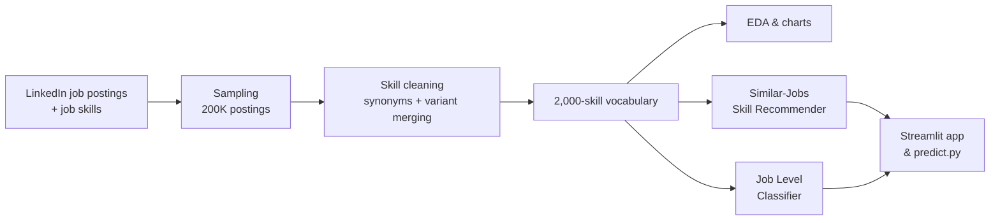

<div align="center">

# 💼 LinkedIn Skills Explorer

### What skills does the job market actually want? An end-to-end ML project on LinkedIn job postings


**[📓 Notebook](analysis.ipynb)** · **[📊 Dataset](https://www.kaggle.com/datasets/asaniczka/1-3m-linkedin-jobs-and-skills-2024)**

</div>

<div align="center">

<video src="images/Demo.mov" width="100%" controls autoplay muted loop>
  Your browser does not support the video tag.
</video>

</div>

---

## 📌 Table of Contents

- [Overview](#-overview)
- [Features](#-features)
- [Key Insights](#-key-insights)
- [Models & Results](#-models--results)
- [How It Works](#%EF%B8%8F-how-it-works)
- [Tech Stack](#%EF%B8%8F-tech-stack)
- [Getting Started](#-getting-started)
- [Using the App](#-using-the-app)
- [Project Structure](#-project-structure)
- [Limitations](#%EF%B8%8F-limitations)
- [Future Work](#-future-work)
- [Author](#-author)

---

## 🎯 Overview

Students and job seekers often don't know which skills employers actually ask for. Job postings are scattered, skill names are messy (`ReactJS`, `react.js`, `React`), and generic requirements like *communication* hide the skills that really matter for a role.

**LinkedIn Skills Explorer** analyzes LinkedIn job postings from 2024 and turns them into:

- 📊 **Insights**: the most in-demand skills overall, in tech roles, and across different fields
- 🔍 **A skill recommender**: type any job title and see the technical skills similar jobs ask for
- 🎯 **A skill gap checker**: compare your skills with a target role and see what to learn next
- 📈 **A job level classifier**: predict whether a role is *Associate* or *Mid senior* and see what drives the decision
- 🖥️ **An interactive Streamlit app** to explore all of the above

It works for **every field**, not only tech: software engineering, data science, nursing, accounting, sales, design, engineering and more.

---

## ✨ Features

| Feature | Description |
|---|---|
| 🧹 **Smart skill cleaning** | Merges spelling variants automatically (`problem-solving`, `problemsolving` → `problem solving`) and maps synonyms (`reactjs` → `react`) |
| 🔍 **Similar-jobs recommender** | Finds the 50 most similar job titles and ranks skills by how specific they are to the role |
| 🧠 **Technical vs general skills** | Soft skills like *communication* are separated so they don't crowd out role-specific skills |
| 🎯 **Skill gap checker** | Shows match %, the skills you already have, and missing skills ranked by demand |
| 📈 **Explainable level prediction** | Shows which title words and skills push a job towards each level |
| 🤗 **Embeddings option** | Uses Sentence-Transformers to match job titles by meaning, not only spelling |
| 🖥️ **Streamlit web app** | Four tabs: skills for a job, skill gap, job level, and insights |
| 💻 **Terminal demo** | `predict.py` for quick testing without a browser |

---

## 📊 Key Insights

### Top technical / field skills (soft skills removed)

<!-- 📷 IMAGE PLACEHOLDER: images/01b_top_technical_skills.png -->
> 📷 **Image:** `images/01b_top_technical_skills.png`

> 💡 **Finding:** _Write your main finding here, e.g. "SQL and Python are the most requested technical skills across all fields."_

### Top skills in CS / tech jobs

<!-- 📷 IMAGE PLACEHOLDER: images/03_tech_skills.png -->
> 📷 **Image:** `images/03_tech_skills.png`

> 💡 **Finding:** _Write your finding here, e.g. which languages, frameworks and cloud tools lead in tech roles._

### Top skills across all jobs

<!-- 📷 IMAGE PLACEHOLDER: images/01_top_skills.png -->
> 📷 **Image:** `images/01_top_skills.png`

> 💡 **Finding:** _Write your finding here, e.g. how general skills dominate when all fields are combined._

### Jobs by level

<!-- 📷 IMAGE PLACEHOLDER: images/02_job_levels.png -->
> 📷 **Image:** `images/02_job_levels.png`

---

## 🤖 Models & Results

### Results summary

<!-- 📷 IMAGE PLACEHOLDER: images/06_model_comparison.png -->
> 📷 **Image:** `images/06_model_comparison.png`

| Model | Task | Metric | Baseline | Score |
|---|---|---|---|---|
| Similar-Jobs Recommender (character TF-IDF) | Recommend skills from a job title | Precision@10 (technical skills) | XX | **XX** |
| Similar-Jobs Recommender (Sentence Embeddings) | Recommend skills from a job title | Precision@10 (technical skills) | XX | **XX** |
| Job Level Classifier (Logistic Regression) | Associate vs Mid senior | Macro F1 | XX | **XX** |

<sub>Scores come from `results/metrics.json`. Baselines: the recommender baseline gives every job the same most popular skills; the classifier baseline always predicts the most common level.</sub>

### Skill recommender: sample predictions across fields

<!-- 📷 IMAGE PLACEHOLDER: images/05_recommendations.png -->
> 📷 **Image:** `images/05_recommendations.png`

### What pushes a job towards each level

<!-- 📷 IMAGE PLACEHOLDER: images/07_level_signals.png -->
> 📷 **Image:** `images/07_level_signals.png`

> 💡 **Finding:** _Write your finding here, e.g. title words like "senior" and "lead" matter more than skills._

### Job level classifier: confusion matrix

<!-- 📷 IMAGE PLACEHOLDER: images/04_confusion_matrix.png -->
> 📷 **Image:** `images/04_confusion_matrix.png`

---

## ⚙️ How It Works



**1. Data loading**
Sampled 200,000 postings from the dataset and joined them with their skills. The skills file is read in chunks, and the multi-GB job summaries file is skipped to keep memory low.

**2. Skill cleaning**
- Lower-casing and removing filler words (`excellent communication skills` → `communication`)
- Manual synonyms (`reactjs`, `react.js` → `react`)
- Automatic merging of variants that differ only by spaces, dots or dashes
- Keeping the 2,000 most common skills

**3. Similar-Jobs Skill Recommender**
- For every unique job title, count how many postings asked for each skill
- For a new title, find the **50 most similar titles** using character n-gram TF-IDF (handles `Full-Stack Engineer`, `Fullstack Developer`, `Sr. ...`)
- Compute the share of similar jobs asking for each skill
- Rank technical skills with a **lift-weighted score**, so skills that are *specific* to the role rank above skills every job asks for
- Optional version uses **Sentence-Transformers (all-MiniLM-L6-v2)** to find similar titles by meaning

**4. Job Level Classifier**
2,000 multi-hot skill features + TF-IDF on job titles → class-balanced Logistic Regression. Its coefficients show which words and skills point to each level.

**5. Evaluation**
Held-out test set (20%). The recommender is measured with **Precision@10**, and the classifier with **Macro F1**, both against simple baselines.

---

## 🛠️ Tech Stack

| Area | Tools |
|---|---|
| Language | Python |
| Data | Pandas, NumPy, SciPy |
| Machine learning | scikit-learn (TF-IDF, Logistic Regression, Nearest Neighbors) |
| NLP / embeddings | Sentence-Transformers, PyTorch |
| Visualization | Matplotlib, Altair |
| App | Streamlit |
| Environment | Jupyter, VS Code, kagglehub |

---

## 🚀 Getting Started

### 1. Clone and install

```bash
git clone https://github.com/<your-username>/linkedin-skills-project.git
cd linkedin-skills-project

python3 -m venv .venv
source .venv/bin/activate        # Windows: .venv\Scripts\activate
pip install -r requirements.txt
```

### 2. Add your Kaggle API token

Download `kaggle.json` from **Kaggle → Settings → API → Create New Token**, then:

```bash
mkdir -p ~/.kaggle
mv ~/Downloads/kaggle.json ~/.kaggle/
chmod 600 ~/.kaggle/kaggle.json
```

### 3. Train the models

Open `analysis.ipynb` in VS Code or Jupyter and click **Run All**. It will:

- download the dataset automatically
- save charts to `images/`
- save trained models to `models/`
- save scores to `results/metrics.json`

> 💡 On a machine with 8 GB RAM, set `SAMPLE_SIZE = 100_000` in the first cell.

### 4. Run the app

```bash
streamlit run app.py
```

Or use the terminal version:

```bash
python predict.py
```

---

## 🖥️ Using the App

### 🔍 Skills for a job
Type any job title, or pick an example, to see the technical and general skills that similar jobs ask for.

<!-- 📷 IMAGE PLACEHOLDER: images/app_skills_tab.png -->
> 📷 **Image:** `images/08_app_skills_tab.png`

### 🎯 Skill gap checker
Choose a target job and your current skills to see your match %, what you already have, and what to learn next.

<!-- 📷 IMAGE PLACEHOLDER: images/app_gap_tab.png -->
> 📷 **Image:** `images/09_app_gap_tab.png`

### 📈 Job level
Enter a job title and skills to predict the job level.

<!-- 📷 IMAGE PLACEHOLDER: images/app_level_tab.png -->
> 📷 **Image:** `images/10_app_level_tab.png`

---

## 📁 Project Structure

```
linkedin-skills-project/
├── analysis.ipynb      # full pipeline: cleaning, EDA, training, evaluation
├── app.py              # Streamlit web app
├── predict.py          # terminal demo
├── skills_engine.py    # shared model logic used by app.py and predict.py
├── requirements.txt
├── images/             # charts and screenshots used in this README
├── results/
│   └── metrics.json    # model scores
└── models/             # trained models (created by the notebook, not uploaded)
```

---

## ⚠️ Limitations

- **Two levels only:** the dataset labels jobs as *Associate* or *Mid senior*, and title words (senior, junior, lead) influence the prediction more than skills do. Seniority usually depends on years of experience, which is not used yet.
- **Market coverage:** results reflect the countries covered by the dataset's LinkedIn searches, not every job market.
- **Automatic skill extraction:** skills come from postings automatically, so some noise remains.
- **Sample:** models are trained on a 200K sample, not all 1.3M postings, to fit on a laptop.

---

## 🔮 Future Work

- [ ] Deploy the app online (Streamlit Community Cloud / Hugging Face Spaces)
- [ ] Upload a resume (PDF) and extract skills automatically for the gap checker
- [ ] Extract years of experience from job descriptions to improve level prediction
- [ ] AI career advisor: generate a learning roadmap from missing skills with an LLM
- [ ] Skill co-occurrence graph: "what to learn after React?"
- [ ] Location and remote-work trends
- [ ] Unit tests, GitHub Actions and Docker

---

## 👤 Author

**Muhammad Aadil**
BS Computer Science, University of Lahore

[](#)
[](#)

---


<div align="center">

⭐ If you found this project useful, consider giving it a star!

</div>
